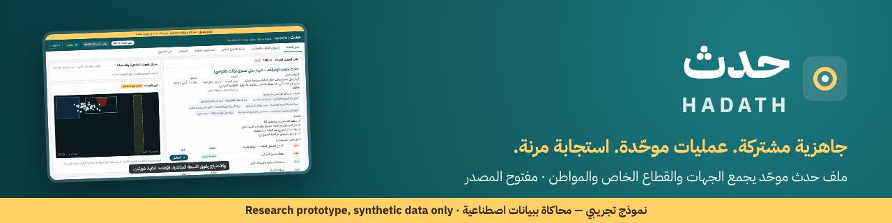

<div dir="rtl">

<p align="center"></p>

<p align="center">
  <a href="LICENSE"></a>
  <a href="https://github.com/Moha-111/hadath/actions/workflows/ci.yml"></a>
  
  
</p>

# حدث | HADATH

**جاهزية مشتركة. عمليات موحّدة. استجابة مرنة.**

> المواطن شريك، مستجيب بحسب تأهيله، وملتزم بالتوجيهات.

**[جرّب العرض التجريبي](https://moha-111.github.io/hadath/)** · [English README](README.en.md)

> [!WARNING]
> **نموذج تجريبي للبحث والمحاكاة فقط — ليس نظامًا معتمدًا للاستخدام أثناء طوارئ حقيقية.**
> جميع البيانات والجهات والأشخاص والمنشأة اصطناعية وخيالية. لا يدّعي المشروع أي شراكة أو اعتماد من أي جهة حكومية أو تجارية.

## ما هو «حدث»؟

نموذج تقني مفتوح المصدر يستكشف سؤالًا واحدًا: **كيف نجمع جاهزية الجهات، وقدرات القطاع الخاص، ومشاركة المواطن في استجابة واحدة متكاملة؟**

يعمل الجميع على **ملف حدث موحّد** واحد يضم: الموقف الحالي، الأهداف، القيادة، الجهات المشاركة، المهام، الموارد، القرارات، طلبات الدعم، سجل التحديثات، والتعافي. وتبقى لكل جهة اختصاصاتها وصلاحياتها، ولكل دور ما يحتاجه فقط.

| الدور | ما يمكن تجربته |
|---|---|
| مدير الحدث | التحقق من البلاغ وإنشاء الملف، الأهداف ومناطق العمل المسموح بها، توزيع المهام وتحديد الأدوات، اعتماد طلبات الدعم، اعتماد بدائل محرك الفجوات، التوجيهات، التعافي |
| مسؤول التأهب والجاهزية | فحص الأدوات وتاريخ آخر تحقق، تأهيل الأفراد، الخطط والتمارين، الفجوات المفتوحة |
| شريك القطاع الخاص | تسجيل قدرات (نقل، إمداد، رعاية، اتصالات) وشروط إتاحتها، تحديث الجاهزية، قبول التفعيل ومتابعة التنفيذ |
| المستجيب المؤهل | بادج تجريبي بالتدريب والاعتماد، تفعيل التوفر اختياريًا، قبول المهمة وتحديثها وتسليمها، الإبلاغ عن عطل |
| المواطن | تعليمات رسمية محاكاة بثلاث لغات، بلاغ مبسّط، تدريب وتمارين، إرشادات الالتزام والخصوصية — دون تفاصيل العمليات الحساسة |

ويضم أيضًا: **خريطة تخطيطية اصطناعية** لأجهزة AED وحقائب الإصابات والسيطرة على النزيف، و**«عين الحدث»** (مصدر مرئي اصطناعي موسوم بوضوح، دون أي اتصال فعلي)، و**محرك فجوات الجاهزية والاستجابة** بقواعد شفافة، و**حالة انقطاع الاتصال** الصريحة.

## التشغيل

المتطلبات: Node.js 20 أو أحدث. لا يحتاج أي خدمة مدفوعة أو مفتاح خارجي أو اتصال بالإنترنت بعد التثبيت.

```bash
npm ci            # تثبيت الاعتماديات
npm run dev       # تشغيل التطبيق: http://localhost:5173
npm test          # تشغيل الاختبارات
npm run build     # بناء نسخة الإنتاج في dist/
npm run scenario  # إعادة تشغيل السيناريو دون واجهة وطباعة المؤشرات (أضف -- --en للإنجليزية)
```

**جولة سريعة (5 دقائق):** افتح التطبيق، ثم افتح «مشغّل السيناريو» أسفل الشاشة ونفّذ الخطوات واحدة تلو الأخرى، متنقلًا بين تبويبات الأدوار لترى الحدث نفسه من كل دور. أو نفّذ الخطوات بنفسك بالأزرار في كل واجهة. التبديل بين العربية والإنجليزية من أعلى الصفحة.

## السيناريو الاصطناعي

حادث افتراضي متعدد الإصابات: **انهيار جزئي لمدرّج مؤقت** أثناء فعالية مجتمعية في «مجمّع الواحة» الخيالي. ليس إعادة تمثيل لأي حدث حقيقي، ولا يستخدم بيانات ضحايا أو مخططات منشآت فعلية. يمر عبر سبع مراحل: قبل الحدث ← البداية ← العمليات ← التكامل ← المرونة (تعطل حقيبة إصابات وتفعيل بديل، وانقطاع الاتصال) ← مشاركة المواطن ← التعافي. السيناريو حتمي: كل تشغيل ينتج الحالة نفسها. التفاصيل في [docs/SCENARIO.md](docs/SCENARIO.md).

## الوثائق

- [المعمارية](docs/ARCHITECTURE.md) · [نموذج البيانات](docs/DATA_MODEL.md) · [الصلاحيات](docs/PERMISSIONS.md)
- [محرك الفجوات](docs/GAP_ENGINE.md) · [السيناريو](docs/SCENARIO.md)
- [المنفّذ والمحاكى والمقترح مستقبلًا](docs/STATUS.md)
- [التكامل المستقبلي (بما فيه توكلنا)](docs/INTEGRATIONS_FUTURE.md)
- [فيديو المحاكاة: طريقة إعادة الإنتاج](recordings/README.md)

## الضوابط

- بيانات اصطناعية فقط، ولا أسرار أو مفاتيح وصول في المستودع.
- لا يُسنِد النظام دخول مناطق الخطر تلقائيًا، ولا يُسند المستجيب المجتمعي إلى منطقة الخطر إطلاقًا. كل إسناد قرار بشري.
- لا قرارات علاجية آلية.
- محرك الفجوات قواعد مكتوبة قابلة للفهم، **وليس نموذج تنبؤ متعلمًا**؛ ولا يُنفّذ أي بديل دون اعتماد مدير الحدث.
- المؤشرات محسوبة من سجل المحاكاة فقط، ولا تمثل نتائج حقيقية أو سريرية.

## المساهمة

نرحب بالمطورين والمصممين والممارسين والباحثين. ابدأ من [CONTRIBUTING.md](CONTRIBUTING.md) وفيه مهام مساهمة جاهزة لكل فئة. نبحث تحديدًا عن: **مراجعة سيناريو العمليات، وتطوير التكاملات التقنية، وتصميم تقييم علمي للأداء.**

اقرأ أيضًا: [مدونة السلوك](CODE_OF_CONDUCT.md) · [سياسة الأمان](SECURITY.md)

## الترخيص

الكود الأصلي مرخّص بموجب [Apache License 2.0](LICENSE). الاعتماديات تخضع لتراخيصها الخاصة: [THIRD_PARTY_LICENSES.md](THIRD_PARTY_LICENSES.md). الخطوط المضمّنة (IBM Plex Sans Arabic وNoto Sans Arabic) مرخّصة بـ SIL Open Font License 1.1.

</div>
